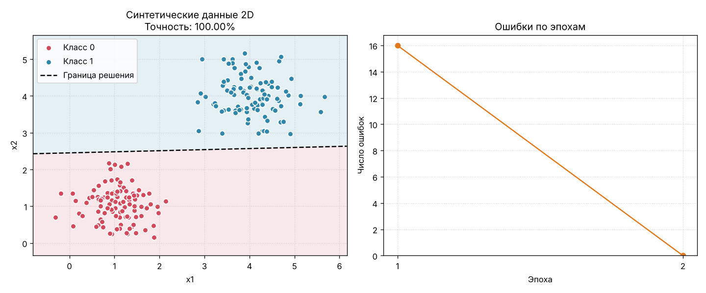
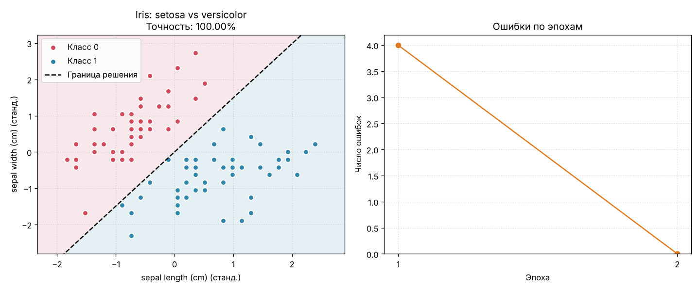

# Перцептрон Розенблатта


Лабораторная работа №1, тема А1. Выполнил: Гребенник Артур, 25КНТ-5.

Программа реализует однослойный перцептрон — линейный бинарный классификатор.
Он считает взвешенную сумму признаков `z = Σ w_i·x_i + bias`, пропускает её через
порог (1, если `z >= 0`, иначе 0) и обучается по правилу Розенблатта
`w += lr·(target − pred)·x`. Модель обучается на синтетических 2D-данных
или на реальном датасете Iris, печатает точность и строит два графика:
границу решения и число ошибок по эпохам.

## Установка

Нужен [uv](https://docs.astral.sh/uv/).

```bash
uv sync
```

## Запуск

```bash
# синтетические данные (команда из задания)
uv run python perceptron.py --samples 200 --lr 0.1 --epochs 50

# то же через установленную команду
uv run perceptron --samples 200 --lr 0.1 --epochs 50

# реальные данные: Iris, классы setosa и versicolor
uv run perceptron --dataset iris --epochs 100

# сохранить графики в файл вместо окна
uv run perceptron --seed 42 --save docs/synthetic.png
```

| Аргумент | По умолчанию | Описание |
|---|---|---|
| `--samples` | 200 | число точек синтетического набора |
| `--lr` | 0.1 | скорость обучения (> 0) |
| `--epochs` | 50 | максимум эпох, обучение останавливается раньше, если ошибок нет |
| `--seed` | нет | зерно генератора для воспроизводимости |
| `--dataset` | `synthetic` | `synthetic` или `iris` |
| `--save` | нет | путь к PNG с графиками |
| `--no-plot` | — | не строить графики |

Пример вывода:

```
Набор данных: synthetic, объектов: 200
Параметры: lr=0.1, максимум эпох=50, пройдено эпох=2
Веса: [-0.0096, 0.3263], bias: -0.8000
Итоговая точность: 1.0000
```

### Синтетические данные



### Iris (setosa vs versicolor)



## Структура

```
src/perceptron_lab/
├── model.py      # класс Perceptron: activate, predict, train, score
├── data.py       # синтетические данные, загрузка Iris, стандартизация
├── plotting.py   # граница решения и график ошибок
├── cli.py        # аргументы командной строки
└── __main__.py   # запуск через python -m perceptron_lab
tests/            # тесты pytest
perceptron.py     # запуск из корня: python perceptron.py ...
```

## Проверки и тесты

```bash
uv run pytest
uv run ruff check .
uv run ruff format --check .
uv run mypy --strict src tests perceptron.py
```

Те же проверки запускаются в GitHub Actions на каждый push
(`.github/workflows/ci.yml`).
